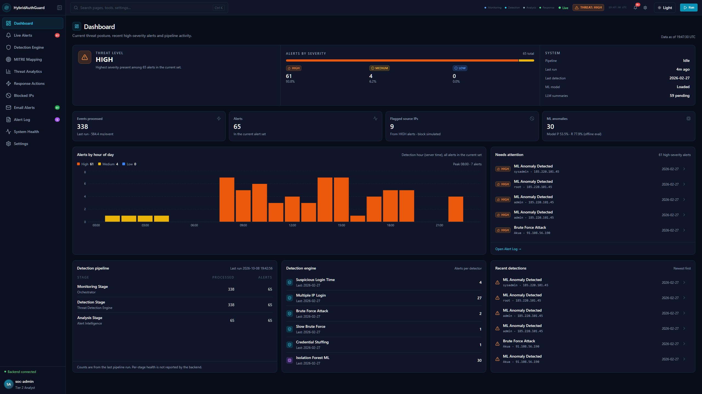
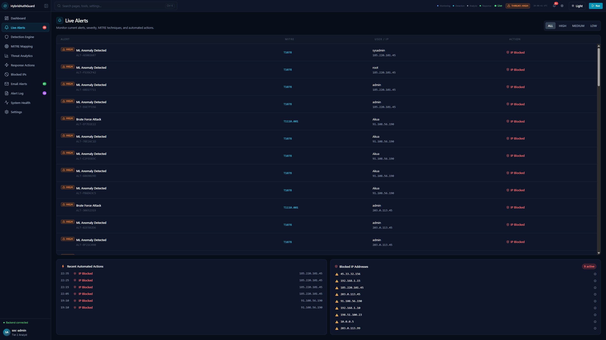
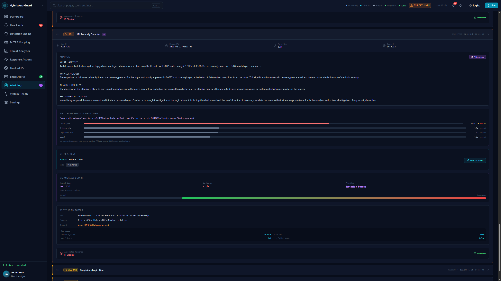
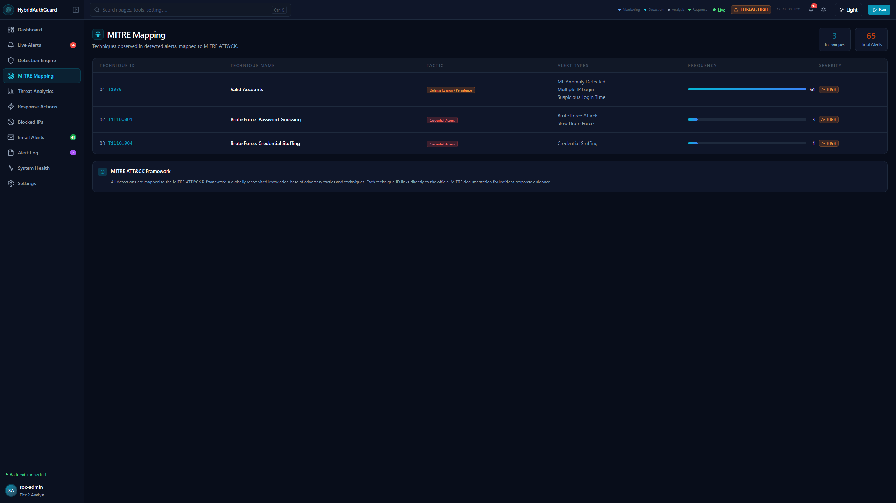
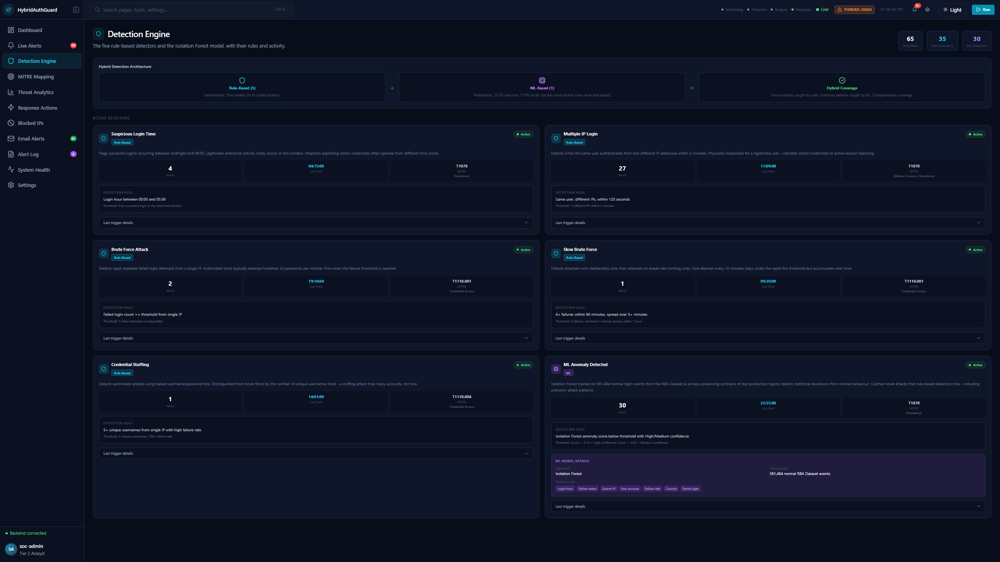
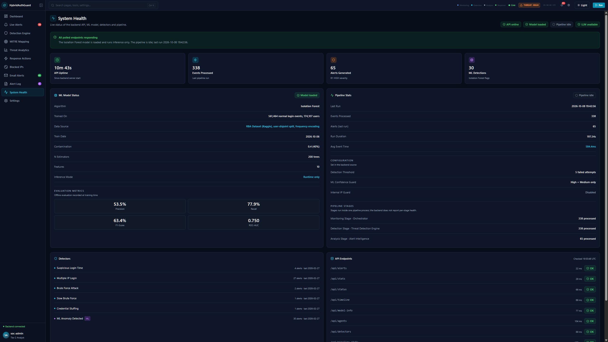
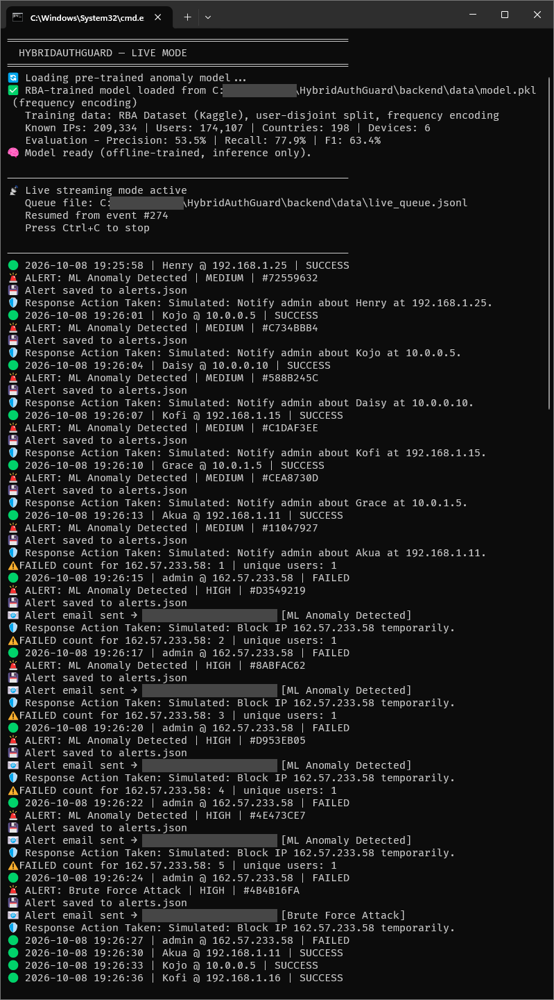
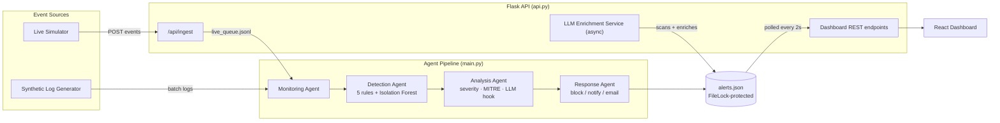

# HybridAuthGuard

**Autonomous Cyber Threat Monitoring and Response System Using Agentic AI**

[](LICENSE)
[](https://www.python.org/downloads/)
[](https://react.dev/)
[]()

A multi-agent intrusion detection system that combines rule-based detection, unsupervised machine learning (Isolation Forest), and LLM-based alert enrichment to detect and respond to authentication-based cyber threats in real time - developed as a final-year BSc Information Technology research project in the Department of Computer Science, University of Ghana. The name HybridAuthGuard reflects its hybrid rule-based plus machine-learning detection engine.

> **TL;DR** - Four cooperating agents (Monitoring → Detection → Analysis → Response) watch a stream of login events, flag suspicious behaviour using five deterministic rules _and_ an Isolation Forest model trained on 561,464 normal login events from the RBA Dataset (a privacy-preserving synthesis of real logins), enrich each alert with a locally-run LLM explanation, map it to MITRE ATT&CK, and surface everything on a live React dashboard.

---

## Table of Contents

- [HybridAuthGuard](#hybridauthguard)
  - [Table of Contents](#table-of-contents)
  - [Motivation](#motivation)
  - [Key Features](#key-features)
  - [Screenshots](#screenshots)
  - [Architecture](#architecture)
  - [Detection Engine](#detection-engine)
  - [ML Model Performance](#ml-model-performance)
    - [Evaluation](#evaluation)
  - [Tech Stack](#tech-stack)
  - [Project Structure](#project-structure)
  - [Getting Started](#getting-started)
  - [Dataset \& Attribution](#dataset--attribution)
  - [Roadmap](#roadmap)
  - [Limitations](#limitations)
  - [Related Work](#related-work)
  - [Citation](#citation)
  - [License](#license)
  - [Acknowledgments](#acknowledgments)

---

## Motivation

Security Operations Centers face two compounding problems: **alert fatigue**, where analysts are overwhelmed by the volume of low-signal notifications from purely rule-based systems, and **dwell time**, where the gap between an attacker's initial access and eventual detection is measured in days or weeks rather than minutes. Purely deterministic detectors catch known attack patterns reliably but miss novel behaviour; purely statistical detectors catch novel behaviour but produce noisy, hard-to-interpret output.

This project explores a **hybrid** answer: deterministic rules for known attack signatures (brute force, credential stuffing, impossible travel, off-hours access) running alongside an unsupervised anomaly detector for everything the rules don't anticipate, with an LLM layer translating raw detector output into analyst-readable explanations.

## Key Features

- **Four-agent pipeline** - Monitoring, Detection, Analysis, and Response agents operate as a sequential pipeline, each with a single clear responsibility.
- **Six detectors, two paradigms** - five deterministic rule-based detectors (brute force, slow/evasive brute force, credential stuffing, multi-IP login, off-hours login) plus one Isolation Forest anomaly detector trained on the RBA Dataset, a privacy-preserving synthesis of real login data.
- **Feature-level ML explainability** - every ML-flagged alert ships with a per-feature standard-deviation breakdown against the training baseline, so "the model flagged this" is never a black box.
- **LLM-powered enrichment** - a locally-hosted `phi3:mini` model (via Ollama) generates structured, analyst-style explanations for every alert, running asynchronously so it never blocks the detection pipeline.
- **MITRE ATT&CK mapping** - every alert type is mapped to a specific ATT&CK technique ID and tactic.
- **Automated response simulation** - severity-driven actions: simulated IP blocking and admin alerting, plus real Gmail SMTP email alerts for HIGH-severity alerts (confirmed working in live mode).
- **Live and batch operation** - a live streaming mode (`/api/ingest` + polling agent) alongside a deterministic batch/demo mode that guarantees all six attack scenarios fire for reproducible evaluation.
- **Full-featured React dashboard** - eleven pages covering live alerts, alert history, detection engine internals, MITRE mapping, blocked IPs, email alert log, system health, and threat analytics, with light/dark theming and a fully responsive mobile layout.

## Screenshots

| Dashboard Overview                           | Live Alert Feed                                  |
| -------------------------------------------- | ------------------------------------------------ |
|  |  |

| Alert Detail (ML Explainability)                   | MITRE ATT&CK Mapping                                 |
| -------------------------------------------------- | ---------------------------------------------------- |
|  |  |

| Detection Engine                                         | System Health                                      |
| -------------------------------------------------------- | -------------------------------------------------- |
|  |  |

| Live Mode (terminal)                                            |
| --------------------------------------------------------------- |
|  |

## Architecture

See [`docs/ARCHITECTURE.md`](docs/ARCHITECTURE.md) for the full breakdown. High-level flow:



## Detection Engine

| Detector              | Type             | Trigger                                                            | MITRE ATT&CK                            |
| --------------------- | ---------------- | ------------------------------------------------------------------ | --------------------------------------- |
| Brute Force Attack    | Rule-based       | ≥5 failed logins from one IP                                       | T1110.001                               |
| Slow Brute Force      | Rule-based       | ≥4 failures spread over 5+ minutes, evading rapid-fire thresholds  | T1110.001                               |
| Credential Stuffing   | Rule-based       | ≥5 unique usernames attempted from one IP with high failure rate   | T1110.004                               |
| Multiple IP Login     | Rule-based       | Same user authenticated from two IPs within 120 seconds            | T1078 (Defense Evasion / Persistence)   |
| Suspicious Login Time | Rule-based       | Successful login between 00:00–05:59                               | T1078 (Persistence)                     |
| ML Anomaly Detection  | Isolation Forest | Statistical deviation from a 561,464-event normal-behaviour baseline | T1078 (Persistence)                   |

Detector evaluation order is deliberate - slow brute force and credential stuffing are checked _before_ the fast brute-force threshold to prevent misclassification (see [`docs/DECISIONS.md`](docs/DECISIONS.md), Decision 9).

## ML Model Performance

Evaluated on a held-out, user-disjoint test split of the RBA Dataset (a privacy-preserving synthesis of real logins, see [Dataset & Attribution](#dataset--attribution)). No user in the test split appears in training, and `contamination` was chosen on the validation split only.

| Metric        | Deployed model (dashboard) | 10-seed mean |
| ------------- | -------------------------- | ------------ |
| Precision     | 53.5%                      | 53.8%        |
| Recall        | 77.9%                      | 77.9%        |
| F1-Score      | 63.4%                      | 63.7%        |
| ROC-AUC       | 0.750                      | 0.755        |

| Setting       | Value                                                                                                                 |
| ------------- | --------------------------------------------------------------------------------------------------------------------- |
| Training size | 561,464 normal login events from 174,107 users                                                                        |
| Algorithm     | Isolation Forest, contamination=0.4 (chosen on validation only), 200 estimators, StandardScaler                       |
| Features      | 10 (cyclic hour encoding, IP/user/country/device frequency in training, cumulative failure rate, novel-IP/country flags) |

These figures replace earlier, higher figures that were computed with `contamination` tuned on the test set and with raw identity IDs as features; see ADR-13 to ADR-15 in [`docs/DECISIONS.md`](docs/DECISIONS.md).

### Evaluation

The full hybrid pipeline (rules + Isolation Forest) compared with the Isolation Forest alone on the same test split:

| Measure                                                | Hybrid | Isolation Forest alone |
| ------------------------------------------------------ | ------ | ---------------------- |
| Campaign recall (share of distinct attacking IPs caught) | 60.0%  | 58.5%                  |
| Alerts per 1,000 events                                | 272.2  | 488.6                  |
| Precision at a 1% attack rate                          | 1.1%   | 2.2%                   |

The hybrid catches slightly more attacking IPs while raising far fewer alerts. At a realistic attack rate, though, precision is low for both: at 1% prevalence, most alerts would be false positives. The test split's attack share is far higher than real traffic, so the headline precision above overstates what an analyst would see in practice.

Processing cost is small: 7.77 ms for 338 events. Run times shown on the dashboard include a demonstration delay of 0.1–1.0 s per event, so they reflect the demo pacing rather than detection cost.

Raw results and the scripts that produced them are in [`backend/results/`](backend/results/README.md).

## Tech Stack

**Backend:** Python 3.12 · Flask · scikit-learn (Isolation Forest) · pandas/numpy · Ollama (`phi3:mini`) · FileLock

**Frontend:** React · Tailwind CSS · Recharts · lucide-react

**Data:** [Wiefling et al.'s RBA Dataset](https://github.com/vs-uulm/2021-RBA-Dataset) (Kaggle mirror)

## Project Structure

```
.
├── backend/
│   ├── main.py                  # Entry point — batch and live modes
│   ├── api.py                   # Flask REST API + LLM enrichment service
│   ├── live_simulator.py        # Continuous event generator for live-mode demos
│   ├── requirements.txt
│   ├── .env.example
│   ├── agents/
│   │   ├── monitoring_agent.py  # Orchestrator — batch + live streaming
│   │   ├── detection_agent.py   # 6 detectors (5 rule-based + 1 ML)
│   │   ├── analysis_agent.py    # Severity, MITRE mapping, LLM explanation
│   │   └── response_agent.py    # Simulated block / notify / email
│   ├── ml/
│   │   ├── anomaly_model.py     # Isolation Forest wrapper, 10-feature extraction
│   │   ├── train_from_dataset.py# RBA dataset trainer (user-disjoint, frequency encoding)
│   │   ├── explainer.py         # Feature-level deviation explainability
│   │   ├── train_from_dataset_v2.py, _v3.py, _v3_extend.py
│   │   │                        # Split, encoding and contamination experiments
│   │   ├── evaluate_hybrid_*.py # Hybrid vs baselines, ablations, final sweep
│   │   └── legacy_features.py   # Pre-revision raw-ID features (Batch 1 baseline only)
│   ├── results/                 # Experiment results (JSON) + README
│   └── utils/
│       ├── alert_manager.py     # FileLock-protected JSON persistence
│       ├── llm_analyzer.py      # phi3:mini via Ollama, async enrichment
│       ├── log_generator.py     # Synthetic log + training data generator
│       ├── log_parser.py        # Raw log text → structured JSON
│       └── email_alerter.py     # Gmail SMTP alerting
├── frontend/
│   ├── .env.example
│   └── src/
│       ├── App.js
│       ├── components/          # Sidebar, Navbar, ConnectionBanner, PageHeader, SeverityBadge
│       ├── config/              # api, appRoutes, chartTheme, severity
│       ├── utils/               # time helpers
│       └── pages/               # 11 dashboard pages
├── docs/
│   ├── ARCHITECTURE.md
│   ├── SETUP.md
│   ├── DECISIONS.md
│   └── screenshots/
├── CITATION.cff
├── CONTRIBUTING.md
├── LICENSE
├── .gitignore
└── README.md
```

## Getting Started

Full instructions in [`docs/SETUP.md`](docs/SETUP.md). Quick version:

```bash
# Backend
cd backend
pip install -r requirements.txt --break-system-packages
cp .env.example .env   # fill in your own values
python main.py --delay 0.1        # batch demo mode

# In separate terminals, for live mode:
python api.py
python main.py --live
python live_simulator.py --rate 1.0 --attack-interval 60

# Frontend
cd frontend
npm install
cp .env.example .env
npm start
```

## Dataset & Attribution

The ML model is trained on the **RBA (Risk-Based Authentication) Dataset**, introduced by Wiefling et al. As the dataset's own authors describe it, it is a privacy-preserving _synthesis_ of 31.3 million real production logins - ground-truth labels and statistical structure are preserved from the original data, while individual field values are regenerated. It is not raw, identifiable login data.

This project samples 700,000 normal and 70,000 attack events and splits them **user-disjoint**, holding out 30% of users entirely:

| Partition  | Size                                          |
| ---------- | --------------------------------------------- |
| Train      | 561,464 normal events (174,107 users)         |
| Validation | 104,268 events                                |
| Test       | 104,268 events                                |

> Wiefling, S., Lo Iacono, L., & Dürmuth, M. (2019). Is this really you? An empirical study on risk-based authentication applied in the wild. _IFIP International Conference on ICT Systems Security and Privacy Protection._

## Roadmap

- [ ] MCP (Model Context Protocol) integration for agent tool-calling
- [ ] Split deployment (Vercel frontend / Render backend)
- [ ] Persistent database backend in place of flat-file `alerts.json`
- [ ] Configurable detection thresholds via a settings API rather than source edits

## Limitations

- Attackers who rotate source IPs evade every rule-based detector, since each rule counts activity per IP.
- Attack labels in the RBA Dataset are mostly attack-IP flags, not confirmed account takeovers.
- Evaluation uses a single dataset; results may not transfer to other environments.
- The MITRE ATT&CK mapping has been reviewed by one rater only.
- The LLM-generated explanations have not been evaluated for accuracy or usefulness.
- At a realistic 1% attack rate, most alerts would be false positives (see [Evaluation](#evaluation)).
- IP blocking is **simulated** - no integration with a real firewall/iptables. Email alerts are real (Gmail SMTP).
- Persistence is a single flat JSON file (`alerts.json`), locked with `FileLock`; suitable for a research prototype, not a multi-instance production deployment.
- LLM enrichment latency is hardware-dependent (60–90s per alert on modest GPUs) and runs asynchronously for this reason.

## Related Work

This project builds on and engages with prior work in hybrid intrusion detection and unsupervised anomaly detection, including comparative studies of Isolation Forest vs. Random Forest for log-based anomaly detection, hybrid rule/ML intrusion detection architectures, and SOC automation literature on alert fatigue and attacker dwell time. Full references are in the accompanying thesis.

## Citation

If you reference this work, please cite it as:

```bibtex
@misc{hybridauthguard-2026,
  author = {Deegbe Cephas Dotse Klenam},
  title  = {Autonomous Cyber Threat Monitoring and Response System Using Agentic AI},
  year   = {2026},
  institution = {University of Ghana, Department of Computer Science},
  note   = {BSc Information Technology final-year project. Software: HybridAuthGuard v2.0.0},
  howpublished = {\url{https://github.com/klenam0/HybridAuthGuard}}
}
```

See [`CITATION.cff`](CITATION.cff) for the machine-readable version (GitHub renders a "Cite this repository" button automatically once this file is present).

## License

MIT - see [LICENSE](LICENSE).

## Acknowledgments

- University of Ghana, Department of Computer Science
- Wiefling et al. for the RBA Dataset
- The open-source maintainers of scikit-learn, Flask, React, and Ollama
